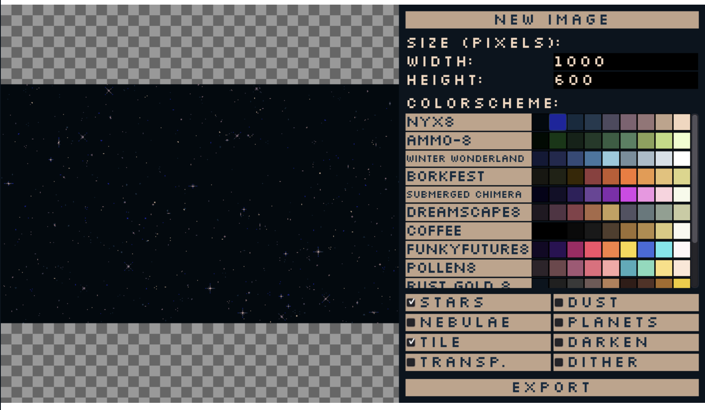

- The background image used was created with: https://deep-fold.itch.io/space-background-generator
- The settings used to create the asset (please note that the image generation is randomized so you may not achieve the same result as me):

- The ship image was obtained from: https://www.vecteezy.com/vector-art/20577582-spaceship-in-pixel-art-style
- The background of it was removed using this website: https://www.remove.bg
- Based on my research this art wasn't created with GenAI.

- The custom pixel messages were created using this website: https://fontmeme.com/pixel-fonts/.

- For some objects/UI elements, I wanted to use shapes as practice (The fuel bar and the safe bar at bottom)